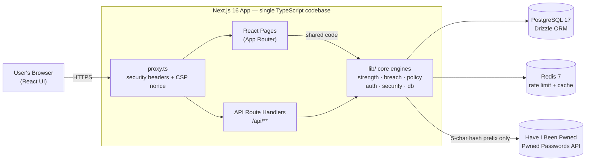
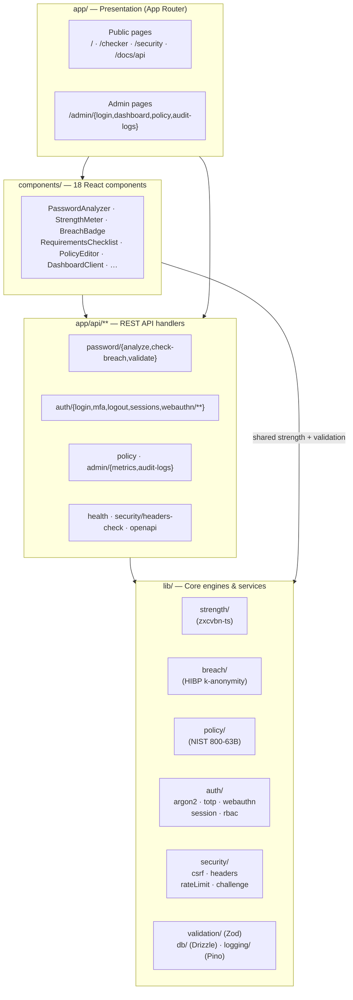
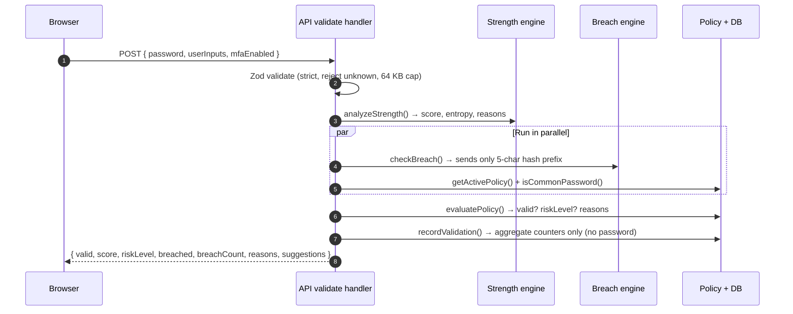
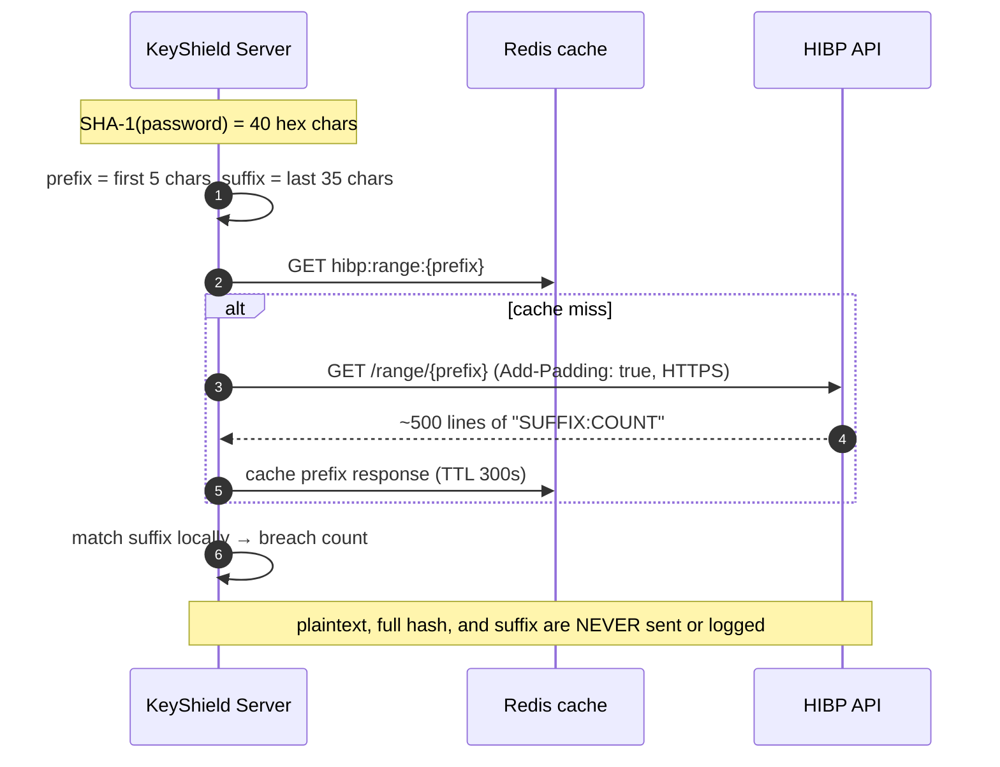
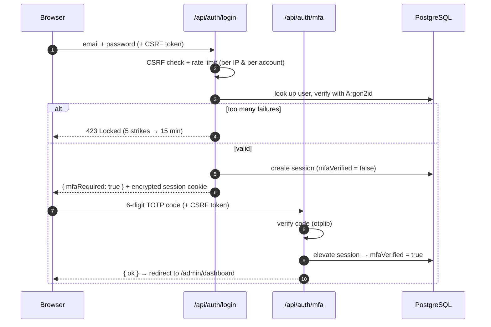
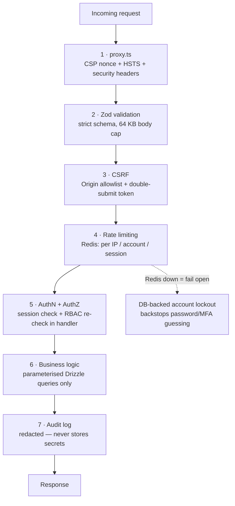
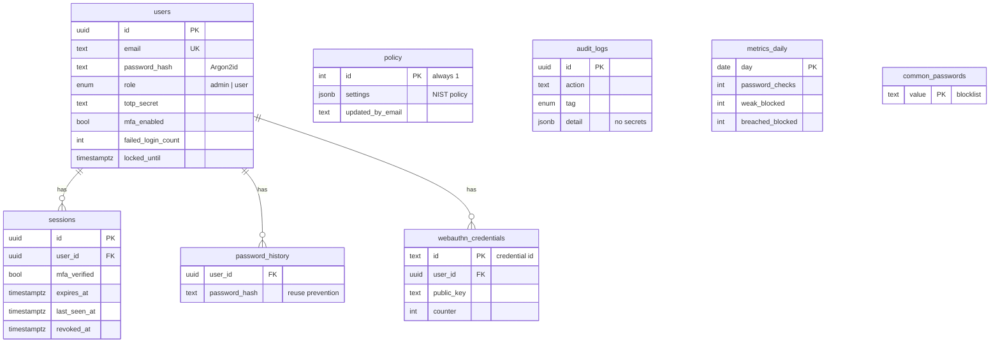
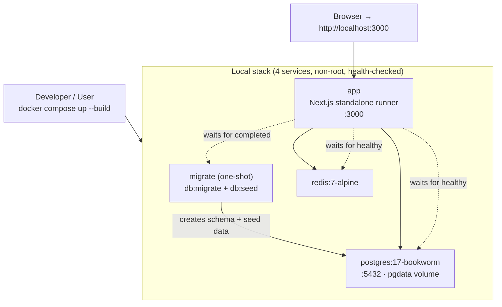

# KeyShield — Architecture

*System architecture of the KeyShield password-security platform. Diagrams below use **Mermaid** — they render automatically in VS Code (Markdown preview), GitHub, and most Markdown viewers.*

---

## 1. Overview

KeyShield is built as a **single full-stack Next.js application in TypeScript** — the web pages (front-end) and the REST API (back-end) live in **one codebase and one language**. This is a deliberate architectural choice: the *exact same* password-strength code and the *exact same* validation rules run on both the browser and the server, so the results can never disagree.

**Guiding principles**
- **One shared engine** — strength analysis and Zod validation schemas are written once and imported by both client and server.
- **Privacy by design** — a password being checked is analysed locally; only a 5-character hash prefix ever leaves the server (and only for the breach lookup).
- **Defence in depth** — every request passes through independent security layers (headers → validation → CSRF → rate limit → auth → parameterised queries → audit).
- **Deny by default** — access is denied unless explicitly allowed, and authorisation is re-checked *inside every* API handler.
- **Framework-agnostic core** — all business logic sits in `lib/`, so it could be lifted into another framework without a rewrite.

---

## 2. High-level system architecture

**Three external dependencies:** PostgreSQL (durable data), Redis (rate limiting + safe breach-cache), and the HIBP API (breach lookups; optional — can run fully offline).

---

## 3. Layered / component architecture

The codebase is organised by responsibility. The `lib/` layer holds all the logic; pages and API handlers are thin and call into it.

---

## 4. Request lifecycle — `POST /api/password/validate`

This is the app's combined verdict (strength + breach + policy) and shows how a request flows through the stack.

> **Key point:** the password is used in memory and discarded — it is never written to the database or the logs. Only anonymous aggregate counts (e.g. "weak blocked +1") are stored.

---

## 5. Breach detection — k-anonymity (the signature feature)

How KeyShield checks a password against ~1 billion leaked passwords **without ever sending it**.

Because hundreds of leaked passwords share the same 5-character prefix, HIBP cannot tell which one is being checked. If HIBP is unreachable, the result degrades to "unknown" (it does **not** wrongly block the user). An **offline mode** checks a local corpus instead, making zero external calls.

---

## 6. Authentication & session flow (admin login)

Sessions are **server-side rows**; the browser holds only an encrypted `httpOnly`+`Secure`+`SameSite` cookie carrying the session id — never a token in localStorage. WebAuthn passkeys are supported as a strong (passwordless) alternative to the TOTP step.

---

## 7. Security — defence in depth

Every state-changing request passes through independent layers. If one fails, the others still stand.

---

## 8. Data model

Eight PostgreSQL tables, managed with Drizzle ORM migrations.

> **Privacy invariant:** a *checked* password is never stored anywhere. `metrics_daily` holds only aggregate counts; `audit_logs` holds only events; passwords/hashes/tokens are never written.

---

## 9. Deployment topology (Docker Compose)

**CI/CD (GitHub Actions):** 7 jobs on every push/PR — quality (typecheck, lint, test, build, SBOM), end-to-end + OWASP ZAP, CodeQL, Semgrep, Trivy, Gitleaks, and a dependency audit.

---

## 10. Technology stack

| Concern | Technology |
|---|---|
| Framework | Next.js 16 (App Router) + React 19 |
| Language | TypeScript (strict) |
| Styling | Tailwind CSS 4 · "Entropy & Vault" design system |
| Strength engine | zxcvbn-ts (shared client + server) |
| Breach lookup | `node:crypto` SHA-1 + HIBP range API |
| Database | PostgreSQL 17 + Drizzle ORM |
| Cache / rate limiting | Redis 7 (ioredis) |
| Password hashing | Argon2id (`@node-rs/argon2`) |
| MFA | otplib (TOTP) + SimpleWebAuthn (passkeys) |
| Sessions | iron-session (encrypted cookies) |
| Validation | Zod (shared schemas) |
| Logging | Pino (with secret redaction) |
| Charts / icons | Recharts · lucide-react |
| Testing | Vitest + Playwright |
| Packaging / CI | Docker Compose · GitHub Actions |

---

## 11. Key design decisions

1. **One Next.js app instead of a separate API service** — the API surface is small (~15 endpoints), and a single TypeScript codebase lets the same strength engine and the same validation schema run on client and server, guaranteeing identical verdicts.
2. **PostgreSQL for relational data** (policy, RBAC, users, audit) and **Redis for ephemeral data** (rate-limit counters, safe breach-cache).
3. **Business logic isolated in `lib/`** so it is framework-agnostic and unit-testable.
4. **Security re-checked in every handler** — never relying on routing/middleware alone.
5. **Local-first analysis** — strength runs in the browser; only a 5-char prefix leaves the server, preserving the privacy promise.

---

## 12. Planned enhancement — Neural guessability (AI/ML)

A compact **neural character-language model** is planned as a complement to zxcvbn: trained offline on a public leaked-password corpus, it scores how *predictable* a password is (predictable ⇒ weak). It will ship as exported weights with **pure-TypeScript inference**, so it runs **locally on-device** like the rest of the strength engine — no GPU, no external calls, privacy preserved. It slots into the existing `lib/strength/` layer and surfaces as an "AI guessability" gauge on `/checker` alongside the classical score.

---

*This architecture reflects the KeyShield codebase as built. Diagrams are Mermaid; open this file in VS Code's Markdown preview to view them rendered.*
